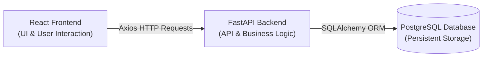

# Fix-My-Ride

**Fix-My-Ride** is a **Motorcycle Service Management System** intended to digitize and streamline motorcycle service centre operations.

> **Current Development Status**
> - **Phase:** Phase 1 — Foundation
> - **Increment:** Commit 02 — Project Overview Documentation
> - **Implementation Status:** Documentation and initial folder structure only. No application code, dependencies, database connections, authentication, API endpoints, or UI components have been implemented yet.

---

## Table of Contents

- [1. Overview & Scope](#1-overview--scope)
- [2. Problem Statement](#2-problem-statement)
- [3. Project Objectives](#3-project-objectives)
- [4. Planned User Roles](#4-planned-user-roles)
- [5. Core Business Workflow (Planned)](#5-core-business-workflow-planned)
- [6. Planned Technology Stack](#6-planned-technology-stack)
- [7. Planned System Architecture](#7-planned-system-architecture)
- [8. Current Project Structure](#8-current-project-structure)
- [9. Development Roadmap](#9-development-roadmap)
- [10. Development Principles](#10-development-principles)

---

## 1. Overview & Scope

Fix-My-Ride is planned as a full-stack web application designed to help motorcycle service centres organize their day-to-day workflows in one structured system.

Once built across upcoming phases, the system is intended to support:

- Customer management
- Motorcycle registration
- Service bookings
- Technician assignments
- Vehicle inspection
- Service activities tracking
- Customer approvals for recommended work
- Invoice generation and payment records

All of the capabilities listed above represent the planned target scope and are not yet built in the repository.

---

## 2. Problem Statement

Many small and mid-sized motorcycle service centres rely on paper registers, spreadsheets, or disconnected messaging tools to run daily operations. Fix-My-Ride is intended to address the following common operational challenges:

- **Manual booking management:** Paper or ad-hoc booking records are prone to scheduling mistakes, missing details, and limited visibility for staff and customers.
- **Difficulty tracking service progress:** Without a shared status trail, staff often have to check the workshop floor manually to know which stage a motorcycle is in.
- **Communication gaps between customers and service centres:** Customers may lack timely updates on inspection findings, additional repair recommendations, or completion status.
- **Difficulty coordinating technicians:** Assigning jobs evenly and tracking which technician is working on which vehicle is harder without a structured assignment view.
- **Lack of centralized service records:** When service notes live in separate notebooks or bills, looking up a motorcycle's past repairs becomes slow and unreliable.
- **Manual invoice and payment tracking:** Preparing bills and recording payments manually increases administrative effort and makes payment history harder to review.

---

## 3. Project Objectives

To address those operational challenges in a structured way, the project aims to:

- **Centralize motorcycle service operations** into a single web-based system.
- **Improve booking visibility** for both customers and service centre staff.
- **Organize technician assignments** so jobs and inspection tasks are clearly tracked.
- **Maintain service history** per customer and motorcycle over time.
- **Improve communication between customers and service centres**, particularly around service recommendations and approvals.
- **Establish a structured digital record of service activities**, invoices, and payments.

---

## 4. Planned User Roles

The application is designed around six planned user roles. **No authentication, role management, or permission system has been implemented yet**; the list below describes planned responsibilities for future commits:

1. **Customer**
   - Create service bookings.
   - View booking status.
   - Review service recommendations.
   - View invoices and service history.

2. **Technician**
   - View assigned jobs.
   - Perform vehicle inspections.
   - Update service activities.

3. **Receptionist**
   - Register customers and motorcycles.
   - Manage incoming service bookings.
   - Coordinate customer communication.

4. **Branch Head**
   - Monitor branch operations.
   - Manage employees and job assignments.
   - Monitor overall service progress.

5. **Showroom Manager**
   - Monitor showroom-related operations.
   - Coordinate relevant business activities.

6. **Application Admin**
   - Manage application-level users and system configurations.

---

## 5. Core Business Workflow (Planned)

The intended end-to-end motorcycle service lifecycle follows these stages:

1. **Customer Registration:** A customer profile is created with basic contact information (either by the customer or a receptionist).
2. **Motorcycle Registration:** The customer's motorcycle details (such as model and registration information) are recorded and linked to their profile.
3. **Service Booking:** A service appointment is requested for a registered motorcycle.
4. **Booking Review:** A receptionist or coordinator reviews the incoming booking details and confirms readiness for service.
5. **Technician Assignment:** A branch head or coordinator assigns a technician to handle the service job.
6. **Vehicle Inspection:** The assigned technician inspects the motorcycle and records observations or issues found.
7. **Service Recommendations:** Based on the inspection, recommended repairs, maintenance tasks, or parts are listed for the customer.
8. **Customer Approval:** The customer reviews the recommendations and approves or declines the proposed work before execution.
9. **Service Execution:** The technician performs the approved service activities and updates job progress.
10. **Invoice Generation:** Once service work is completed, an itemized invoice is generated for the approved activities.
11. **Payment Recording:** Payment details against the invoice are recorded in the system.
12. **Service History:** The completed visit, inspection notes, work performed, and billing record remain stored in the motorcycle's service history for future reference.

---

## 6. Planned Technology Stack

None of the packages or services below are installed or configured yet; they represent the planned stack to be introduced incrementally:

### Frontend

- **React:** Component-based library for building interactive user interfaces cleanly and modularly.
- **Vite:** Modern frontend build tool and development server that provides fast local startup and bundling.
- **JavaScript:** Primary programming language for frontend application logic and UI behavior.
- **Material UI (MUI):** React UI component library used to build consistent, accessible layouts, forms, tables, and navigation elements.
- **CSS:** Stylesheets used for custom layout adjustments, spacing, and visual styling alongside Material UI.
- **Axios:** Promise-based HTTP client used by the frontend to send requests to and receive responses from the backend API.

### Backend

- **Python:** Primary programming language for backend business logic, data validation, and server-side workflows.
- **FastAPI:** Modern Python web framework used to define REST API endpoints, handle HTTP requests/responses, and validate data cleanly.

### ORM

- **SQLAlchemy:** Object-Relational Mapper (ORM) that lets Python code interact with database tables and relationships using Python classes instead of raw SQL everywhere.

### Database

- **PostgreSQL:** Relational database management system used to reliably store structured application data such as customers, motorcycles, bookings, service activities, invoices, and payments.

---

## 7. Planned System Architecture

Fix-My-Ride follows a layered client–server architecture where each layer has a clear, focused responsibility:



### Layer Responsibilities

- **React Frontend:** Renders screens in the user's browser, manages client-side UI state, collects form inputs, and displays data returned from the server.
- **Axios HTTP Requests:** Acts as the communication bridge between the browser and the backend server by sending structured HTTP requests (such as `GET`, `POST`, `PUT`, `DELETE`) and handling API responses or errors.
- **FastAPI Backend:** Exposes REST API endpoints, validates incoming request payloads, enforces business rules and workflows, and orchestrates responses back to the frontend.
- **SQLAlchemy ORM:** Translates Python objects and queries into database operations, managing table models, relationships, and database sessions cleanly.
- **PostgreSQL Database:** Stores all application records persistently and enforces relational data integrity across customers, motorcycles, bookings, inspections, invoices, and payments.

---

## 8. Current Project Structure

At the current stage (**Commit 02**), only the initial directory skeleton and documentation files exist:

```text
fix_my_ride/
├── README.md
├── backend/
│   └── README.md
├── docs/
│   └── commits/
│       └── 01-project-skeleton.md
└── frontend/
    └── README.md
```

### Directory Responsibilities

- **`frontend/`:** Reserved for the future React + Vite frontend application (currently contains only its placeholder `README.md`).
- **`backend/`:** Reserved for the future Python + FastAPI backend application and database integration code (currently contains only its placeholder `README.md`).
- **`docs/`:** Holds project documentation and learning resources.
- **`docs/commits/`:** Stores commit-by-commit learning guides explaining what each increment builds and why (currently contains `01-project-skeleton.md`).

> Application source files, configuration files (`package.json`, `requirements.txt`), database schemas, and tests do not exist yet and will be introduced in upcoming commits.

---

## 9. Development Roadmap

Fix-My-Ride is organized into five structured development phases:

1. **Phase 1: Foundation** *(Current Phase — consists of 20 incremental commits)*  
   Establishes the repository structure, documentation, core project setup, and foundational tooling/scaffolding before feature development begins.
2. **Phase 2: Database Foundation**  
   Sets up the PostgreSQL connection, SQLAlchemy configuration, core data models, and database schema foundations.
3. **Phase 3: Core Business Modules**  
   Implements foundational user, customer, and motorcycle management modules along with core API and UI workflows.
4. **Phase 4: Service Operations**  
   Builds the operational service lifecycle: service bookings, technician assignments, inspections, service recommendations, customer approvals, and activity updates.
5. **Phase 5: Business Management**  
   Adds invoicing, payment recording, service history views, and operational oversight capabilities for branch and showroom management roles.

---

## 10. Development Principles

This project follows strict engineering and learning practices across every phase:

- **Incremental development:** Build the application step by step in small, manageable pieces rather than writing large unverified changes at once.
- **One meaningful Git commit per increment:** Keep each commit focused on a single clear objective with a descriptive commit message.
- **Beginner-friendly code:** Favor clarity, readable naming, and straightforward patterns over overly clever abstractions.
- **Clear separation of responsibilities:** Keep frontend presentation, backend API/business logic, ORM models, and documentation cleanly separated.
- **Documentation for every commit:** Maintain clear explanations alongside code changes so every step of the build is easy to follow.
- **Testing before committing:** Verify each change works as expected (and leaves the project clean) before committing.
- **Avoid unnecessary complexity:** Introduce tools, patterns, and features only when they are needed for the current increment.
