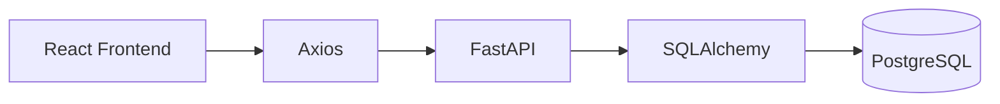

# Commit 02: Project Overview Documentation

**Phase:** Phase 1 — Foundation  
**Increment:** Commit 02 of 20

---

## 1. Objective of Commit 02

The objective of **Commit 02** is to document the complete vision, scope, architecture, and development plan for **Fix-My-Ride** inside the root `README.md` before writing any application code.

Instead of jumping straight into coding without a blueprint, this step makes sure anyone reading the repository understands **what** we are building, **who** it is for, **why** each technology is chosen, and **how** the project will grow step by step.

---

## 2. What is Fix-My-Ride?

**Fix-My-Ride** is a planned full-stack web application—a **Motorcycle Service Management System**—designed to digitize and organize the daily operations of motorcycle service centres.

Once built across future development phases, it is intended to support:

- Customer management
- Motorcycle registration
- Service bookings
- Technician assignments
- Vehicle inspection
- Service activities tracking
- Customer approvals for recommended work
- Invoice generation and payment records

> **Important Note:** All of these features represent the **planned target scope**. At Commit 02, none of these features are implemented yet—only the folder structure and overview documentation exist.

---

## 3. Problem Statement

Many small and mid-sized motorcycle service centres still manage their workshops using paper notebooks, scattered spreadsheets, or informal phone messages. That leads to everyday operational problems:

- **Manual booking management:** Paper or ad-hoc booking lists make it easy to double-book slots, lose customer details, or miss follow-ups.
- **Difficulty tracking service progress:** Without a shared digital status, staff have to walk onto the workshop floor just to find out whether a bike is waiting, under inspection, or ready for pickup.
- **Communication gaps between customers and service centres:** Customers often do not receive timely updates when technicians find extra issues or recommend repairs.
- **Difficulty coordinating technicians:** Without a central assignment view, it is harder to balance workloads or see which technician is handling which motorcycle.
- **Lack of centralized service records:** Looking up a motorcycle's past repairs across old paper bills is slow and unreliable.
- **Manual invoice and payment tracking:** Writing bills and tracking payments by hand takes extra administrative time and increases the chance of mistakes.

---

## 4. Project Objectives

To solve these workshop challenges in a structured way, **Fix-My-Ride** aims to:

- **Centralize motorcycle service operations** into a single web-based system.
- **Improve booking visibility** for both customers and service centre staff.
- **Organize technician assignments** so every job and inspection task is clearly tracked.
- **Maintain service history** for each customer and motorcycle over time.
- **Improve communication between customers and service centres**, especially around repair recommendations and approvals.
- **Establish a structured digital record** of service activities, itemized invoices, and payments.

---

## 5. Understanding the Six User Roles

In a real motorcycle service centre, different people do different jobs. **Fix-My-Ride** is planned around **six user roles**, each with focused responsibilities:

1. **Customer**  
   Brings in a motorcycle for service. In the planned system, a customer can create service bookings, check booking status, review repair recommendations (and approve or decline them), and view invoices and past service history.
2. **Technician**  
   Works on the motorcycles in the workshop. Planned tasks include viewing assigned jobs, performing vehicle inspections, and updating service activity progress.
3. **Receptionist**  
   Serves as the front-desk point of contact. Planned tasks include registering customers and motorcycles, managing incoming service bookings, and coordinating customer communication.
4. **Branch Head**  
   Oversees a service branch. Planned responsibilities include monitoring branch operations, managing employees and job assignments, and tracking overall service progress.
5. **Showroom Manager**  
   Oversees showroom-side activities connected to the service centre and coordinates relevant business operations.
6. **Application Admin**  
   Manages the software itself at the administrative level, including application users and system-wide configurations.

> **Implementation Status:** No login system, authentication, user accounts, or role permissions exist yet. These roles describe the **planned design** for future phases.

---

## 6. Understanding the Core Business Workflow

The planned end-to-end motorcycle service lifecycle follows **12 clear steps** from arrival to completed history:

1. **Customer Registration:** A customer profile with basic contact details is created (by the customer or a receptionist).
2. **Motorcycle Registration:** The customer's motorcycle details (such as model and registration number) are recorded and linked to their profile.
3. **Service Booking:** A service appointment is requested for a registered motorcycle.
4. **Booking Review:** A receptionist or coordinator checks the booking details and confirms readiness for service.
5. **Technician Assignment:** A branch head or coordinator assigns a technician to the service job.
6. **Vehicle Inspection:** The technician inspects the motorcycle and records observations or issues found.
7. **Service Recommendations:** Based on the inspection, recommended repairs, maintenance tasks, or parts are listed for the customer.
8. **Customer Approval:** The customer reviews those recommendations and approves or declines the extra work before it is carried out.
9. **Service Execution:** The technician completes the approved service activities and updates the job status.
10. **Invoice Generation:** Once work is finished, an itemized invoice is generated for the approved activities.
11. **Payment Recording:** Payment details against that invoice are recorded in the system.
12. **Service History:** The visit details, inspection notes, work performed, and billing record stay saved in the motorcycle's history for future visits.

All 12 stages above are **planned workflows** to be built incrementally in later phases.

---

## 7. Understanding the Technology Stack

Every tool in the Fix-My-Ride technology stack has a specific job. None of these packages or databases are installed yet—they form the **planned stack** we will introduce step by step:

### Frontend (What the User Sees in the Browser)

- **React:** A popular JavaScript library for building user interfaces out of reusable pieces called *components* (like buttons, forms, and tables).
- **Vite:** A fast development server and build tool that starts the React app quickly during development and bundles it for production.
- **JavaScript:** The programming language that powers interactive behavior in the browser.
- **Material UI (MUI):** A ready-to-use React component library that provides clean, consistent layouts, forms, tables, and navigation menus.
- **CSS:** Stylesheets used alongside Material UI for custom spacing, layout tweaks, and visual styling.
- **Axios:** A JavaScript library used by the frontend to send HTTP requests (such as fetching bookings or submitting a form) to the backend API and receive responses.

### Backend, ORM, and Database (Behind-the-Scenes Server & Storage)

- **Python:** The programming language used to write the server-side business logic and data validation.
- **FastAPI:** A modern Python web framework used to build REST API endpoints (URLs the frontend calls to read or save data).
- **SQLAlchemy:** An **Object-Relational Mapper (ORM)**. Instead of writing raw SQL queries everywhere, SQLAlchemy lets Python code represent database tables as Python classes and objects.
- **PostgreSQL:** A reliable relational database management system that stores structured data (customers, motorcycles, bookings, inspections, invoices, and payments) permanently on disk.

---

## 8. Understanding Frontend and Backend Architecture

Fix-My-Ride uses a **layered client–server architecture**. In plain terms, the **frontend** runs in the user's web browser, while the **backend** runs on a server and talks to the **database**. Keeping these layers separate makes the project easier to understand, test, and maintain.

The diagram below shows how data is **planned** to flow across the system:



> **Note:** This diagram illustrates the **planned architecture** for Fix-My-Ride—it is **not** an already implemented integration. At Commit 02, no frontend code, Axios calls, FastAPI endpoints, SQLAlchemy models, or PostgreSQL database connections exist yet.

### How the Planned Layers Work Together

1. **React Frontend:** Displays screens in the browser, collects user input (like a booking form), and renders data on screen.
2. **Axios:** Carries HTTP requests (`GET`, `POST`, `PUT`, `DELETE`) from React to the FastAPI server and brings back JSON responses.
3. **FastAPI:** Receives the request, checks that the data is valid, applies business rules, and decides what should happen.
4. **SQLAlchemy:** Translates Python actions into database queries and maps database rows back into Python objects.
5. **PostgreSQL:** Permanently stores the records and enforces relationships (such as linking a motorcycle to its owner).

---

## 9. Understanding the Project Folder Structure

At the stage of **Commit 02**, the repository contains only top-level documentation and empty placeholder folders for the future frontend and backend:

```text
fix_my_ride/
├── README.md
├── backend/
│   └── README.md
├── docs/
│   └── commits/
│       └── 01-project-skeleton.md
└── frontend/
    └── README.md
```

### Purpose of Each Directory

- **`fix_my_ride/` (Project Root):** Holds the main `README.md` with the overall project blueprint and top-level subdirectories.
- **`frontend/`:** Reserved for the future React + Vite user interface. At Commit 02, it contains only its placeholder `README.md`.
- **`backend/`:** Reserved for the future Python + FastAPI server and database code. At Commit 02, it contains only its placeholder `README.md`.
- **`docs/commits/`:** Stores commit-by-commit learning guides (starting with `01-project-skeleton.md`) explaining what each increment adds and why.

*(Later commits in Phase 1 add files like `.gitignore` and `02-project-overview.md` on top of this Commit 02 state.)*

---

## 10. Development Phases

Fix-My-Ride is structured into **five sequential development phases** so the system is built cleanly from the ground up:

1. **Phase 1: Foundation** *(Current Phase — 20 incremental commits)*  
   Sets up the repository layout, project overview documentation, `.gitignore`, tooling, and foundational scaffolding before writing feature code.
2. **Phase 2: Database Foundation**  
   Configures the PostgreSQL connection, SQLAlchemy setup, core database models, and schema foundations.
3. **Phase 3: Core Business Modules**  
   Implements user, customer, and motorcycle management modules along with their initial API endpoints and UI screens.
4. **Phase 4: Service Operations**  
   Builds the core workshop workflow: service bookings, technician assignments, vehicle inspections, service recommendations, customer approvals, and service activity updates.
5. **Phase 5: Business Management**  
   Adds invoice generation, payment recording, service history views, and operational oversight for branch and showroom management roles.

---

## 11. Development Principles

Every commit in Fix-My-Ride follows seven practical engineering and learning principles:

- **Incremental development:** Build the application in small, understandable steps instead of huge changes all at once.
- **One meaningful Git commit per increment:** Keep each commit focused on a single clear purpose with a descriptive message.
- **Beginner-friendly code:** Prefer clear, readable names and straightforward logic over clever shortcuts.
- **Clear separation of responsibilities:** Keep UI presentation, API/business logic, database models, and documentation cleanly separated.
- **Documentation for every commit:** Pair each step with plain-English notes explaining what changed and why.
- **Testing before committing:** Verify that every change behaves as expected before committing it.
- **Avoid unnecessary complexity:** Only add tools, libraries, or patterns when the current step actually needs them.

---

## 12. Files Modified

In **Commit 02**, only one file was updated:

- `README.md` — Expanded from a brief initial placeholder into the complete project overview covering scope, problem statement, objectives, six planned user roles, the 12-step service workflow, planned tech stack, layered architecture diagram, folder structure, roadmap, and development principles.

*(And this learning guide `docs/commits/02-project-overview.md` completes the Commit 02 documentation trail.)*

---

## 13. What We Accomplished

- Defined the full problem statement and goals for Fix-My-Ride in `README.md`.
- Documented the six planned user roles and the 12-stage motorcycle service workflow.
- Documented the planned frontend and backend technology stack and layered architecture.
- Laid out the five-phase development roadmap and the engineering principles guiding every commit.
- Clearly marked what is planned versus what exists today so there is no confusion about implementation status.

---

## 14. What We Have Not Implemented

To keep Phase 1 disciplined and incremental, **none** of the following exist at Commit 02:

- No React, Vite, Material UI, Axios, or CSS source files or `package.json`.
- No Python, FastAPI, or SQLAlchemy source files or `requirements.txt`.
- No PostgreSQL database instance, tables, migrations, or seed data.
- No authentication, login screens, or role-based access control.
- No REST API endpoints, UI pages, forms, or automated tests.

---

## 15. Git Commit Message

The Git commit message used for Commit 02 in the repository history is:

```text
docs: add project overview
```
