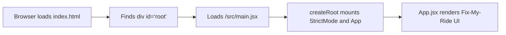

# Commit 08: Configure Application Entry Point

**Phase:** Phase 1 — Foundation  
**Increment:** Commit 08 of 20

---

## 1. Commit Objective

The objective of **Commit 08** is to review and document the responsibilities of the React application's entry point (`frontend/index.html` and `frontend/src/main.jsx`) and its root component (`frontend/src/App.jsx`).

The initial React + Vite application was created in **Commit 05** and organized into folders in **Commit 07**. Rather than rewriting working files unnecessarily, this step verifies that each startup file has a single, clear responsibility and documents how the application boots from the browser's HTML page into React.

---

## 2. How a React Application Starts

When you open a traditional website, the browser receives complete HTML pages directly from a server. A **React Single Page Application (SPA)** works differently:

1. The browser loads a single minimal HTML file (`frontend/index.html`).
2. Inside `index.html`, there is an empty container element (`<div id="root"></div>`) and a `<script type="module" src="/src/main.jsx"></script>` tag.
3. The browser loads and runs `src/main.jsx`.
4. `main.jsx` uses React's `createRoot` to attach React to that `#root` element and renders `<App />` inside it.
5. `App.jsx` produces the user interface (currently the Fix-My-Ride welcome screen) and React keeps it updated in the browser.



---

## 3. Browser and HTML Document Responsibilities

`frontend/index.html` is the **browser's starting point**. Its responsibilities are intentionally minimal:

- Declare standard HTML metadata (`UTF-8` character encoding and responsive `viewport` meta tag).
- Set the browser tab icon (`/favicon.svg`) and page `<title>` (`Fix-My-Ride`).
- Provide the mount target `<div id="root"></div>`.
- Load the Vite JavaScript module entry script `/src/main.jsx`.

`index.html` should **not** contain application markup, React logic, or unrelated external scripts.

---

## 4. Explanation of the Root DOM Element

Inside `frontend/index.html`:

```html
<div id="root"></div>
```

This empty `<div>` is called the **root DOM element**. It starts completely blank in the HTML file. Once JavaScript executes, React takes ownership of everything inside `#root` and renders the entire Fix-My-Ride interface inside it.

---

## 5. Explanation of `main.jsx`

`frontend/src/main.jsx` is the **JavaScript application entry point**:

```jsx
import { StrictMode } from 'react';
import { createRoot } from 'react-dom/client';
import './index.css';
import App from './App.jsx';

// Mount the root React component into the #root element in index.html.
createRoot(document.getElementById('root')).render(
  <StrictMode>
    <App />
  </StrictMode>
);
```

Its responsibilities are strictly limited to bootstrapping the app:

- Importing `StrictMode` from `react`.
- Importing `createRoot` from `react-dom/client`.
- Importing global styles (`./index.css`).
- Importing the root `App` component (`./App.jsx`).
- Finding `#root` in the DOM and mounting `<App />`.

It contains **no** UI markup, business logic, routing, or API requests.

---

## 6. Explanation of `createRoot`

`createRoot` (imported from `react-dom/client`) is React's modern mounting API introduced in React 18+.

- Calling `createRoot(document.getElementById('root'))` creates a React root controller attached to the `#root` DOM node.
- Calling `.render(...)` on that root tells React to render the given JSX tree (`<StrictMode><App /></StrictMode>`) inside `#root`.

---

## 7. Explanation of `React.StrictMode`

`<StrictMode>` (imported as `StrictMode` from `react`) is a development helper component that wraps `<App />`.

- In **development mode**, it runs extra checks and warns in the browser console if components use unsafe patterns or legacy APIs.
- It renders **no** visible HTML elements on screen and is automatically disabled in **production builds** (`npm run build`), adding zero runtime overhead for real users.

---

## 8. Explanation of `App.jsx`

`frontend/src/App.jsx` is the **root React component**:

```jsx
import './App.css';

function App() {
  return (
    <main className="welcome-page">
      <section className="welcome-card">
        <h1 className="welcome-title">Fix-My-Ride</h1>
        <p className="welcome-subtitle">Motorcycle Service Management System</p>
        <p className="welcome-message">Welcome to Fix-My-Ride.</p>
        <p className="welcome-description">
          Your motorcycle service management platform.
        </p>
      </section>
    </main>
  );
}

export default App;
```

Currently, `App.jsx` renders the clean Fix-My-Ride welcome screen using `App.css`. Later in Phase 1 and beyond, it will serve as the top-level shell connecting layouts and routed pages—while staying free of low-level DOM mounting logic.

---

## 9. Difference Between an Entry Point and a Root Component

| Concept | File | Primary Question It Answers | Responsibilities |
| :--- | :--- | :--- | :--- |
| **Entry Point** | `src/main.jsx` | *"How does React attach to the HTML page?"* | Imports global CSS, `createRoot`, `StrictMode`, and `App`; mounts React into `#root`. |
| **Root Component** | `src/App.jsx` | *"What is the top-level UI of the application?"* | Returns JSX for the application UI and imports component-level styles (`App.css`). |

Keeping these two roles separate ensures startup configuration never gets tangled with screen design.

---

## 10. How the Files Connect

1. **`frontend/index.html`** defines `<div id="root"></div>` and loads **`/src/main.jsx`**.
2. **`frontend/src/main.jsx`** loads global base styles (**`./index.css`**), locates `#root`, and mounts **`./App.jsx`** inside `<StrictMode>`.
3. **`frontend/src/App.jsx`** loads **`./App.css`** and renders the welcome screen JSX into the mounted React tree.

---

## 11. Files Modified

- Modified `frontend/README.md` — Added a dedicated section documenting the application startup lifecycle (`index.html`, `main.jsx`, `createRoot`, `React.StrictMode`, and `App.jsx`).
- Created `docs/commits/08-application-entry-point.md` — This learning guide documenting Commit 08.

### Review of Existing Application Code (No Code Changes Needed)

Inspection of `frontend/index.html`, `frontend/src/main.jsx`, `frontend/src/App.jsx`, `frontend/src/index.css`, and `frontend/src/App.css` confirmed that all files from Commit 05 already satisfy every Commit 08 requirement:

- `index.html` already has `<title>Fix-My-Ride</title>`, `<div id="root"></div>`, `<script type="module" src="/src/main.jsx"></script>`, and no extraneous template markup.
- `main.jsx` already imports `StrictMode`, `createRoot`, `./index.css`, and `App`, and mounts `<App />` into `document.getElementById('root')` with no UI or business logic.
- `App.jsx` already serves as a clean, minimal root component rendering the exact welcome screen text with no routing, API calls, or unnecessary nesting.

Because the existing code was already clean and accurate, no unnecessary edits were made to `index.html`, `main.jsx`, `App.jsx`, or CSS files.

---

## 12. Implementation Explanation

1. Audited `frontend/index.html`, `frontend/src/main.jsx`, `frontend/src/App.jsx`, `frontend/src/index.css`, `frontend/src/App.css`, and the Commit 07 `src/` folder structure.
2. Verified clean separation of responsibilities across HTML shell (`index.html`), React bootstrap (`main.jsx`), and root UI (`App.jsx`).
3. Preserved the existing working implementation untouched instead of introducing artificial churn.
4. Added clear beginner-friendly documentation in `frontend/README.md` and `docs/commits/08-application-entry-point.md`.

---

## 13. How to Run the Application

From the `frontend/` directory:

```bash
cd frontend
npm run dev
```

Open the local URL displayed by Vite (typically `http://localhost:5173`) in your web browser.

---

## 14. How to Verify It

Run the production build from `frontend/`:

```bash
cd frontend
npm run build
```

You can also inspect `frontend/index.html`, `frontend/src/main.jsx`, and `frontend/src/App.jsx` to confirm the `<div id="root"></div>` mount target, `/src/main.jsx` module script, `createRoot` call, `<StrictMode>`, and `App` component remain intact.

---

## 15. Expected Results

- `npm run build` exits with code `0` and bundles `index.html`, CSS, and JavaScript into `frontend/dist/`.
- Starting `npm run dev` serves `index.html` with `<div id="root"></div>` and loads `/src/main.jsx` to mount `<App />`.
- The welcome screen displays:
  - **Fix-My-Ride**
  - **Motorcycle Service Management System**
  - **Welcome to Fix-My-Ride.**
  - **Your motorcycle service management platform.**

---

## 16. What Has Been Completed

- Reviewed `frontend/index.html`, `frontend/src/main.jsx`, `frontend/src/App.jsx`, and CSS import relationships.
- Confirmed clear separation between HTML document shell, entry point bootstrap, and root component.
- Documented the React startup flow in `frontend/README.md` and `docs/commits/08-application-entry-point.md`.
- Verified the production build continues to pass cleanly.

---

## 17. What Is Intentionally Not Implemented

To keep Commit 08 focused strictly on the application entry point and root component:

- No new pages (`pages/`), layouts (`layouts/`), headers, or sidebars were created.
- No React Router navigation or route definitions were added.
- No Axios setup, API calls, backend connection, or database integration exists.
- No Material UI components or visual redesigns were introduced.
- No additional npm packages were installed.

---

## 18. Suggested Git Commit Message

```text
feat(frontend): create application entry point
```
