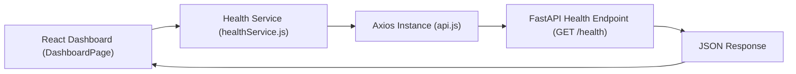

# Commit 20: Integrate React with FastAPI Using Axios

**Phase:** Phase 1 — Foundation *(Final Commit of Phase 1)*  
**Increment:** Commit 20 of 20

---

## 1. Commit Objective

The objective of **Commit 20** is to connect the **Fix-My-Ride** React frontend to the FastAPI backend using **Axios**, so `DashboardPage` calls the backend's `GET /health` endpoint and displays real connection status (`loading`, `connected`, or `disconnected` with a **Retry** button).

This commit completes **Phase 1 — Foundation**, bringing together every foundational piece built across Commits 01–20.

---

## 2. Understanding Frontend–Backend Communication

Right now, the frontend runs on `http://localhost:5173` (Vite) and the backend runs on `http://127.0.0.1:8000` (Uvicorn/FastAPI). They are two separate programs:

- The **frontend** renders UI screens in the browser.
- The **backend** waits for HTTP requests and sends back JSON data.

To display live server status on the Dashboard, React needs an HTTP client library (**Axios**) to send a `GET /health` request over HTTP and handle the JSON response.

---

## 3. What Is Axios?

**Axios** is a popular JavaScript HTTP client library for browsers and Node.js. It simplifies sending `GET`, `POST`, `PUT`, and `DELETE` requests to REST APIs, automatically parses JSON responses into JavaScript objects (`response.data`), and rejects clearly on network failures or HTTP errors so `try/catch` error handling is straightforward.

---

## 4. Why We Use an Axios Instance

Instead of calling `axios.get('http://localhost:8000/health')` directly inside components, we create **one configured Axios instance** in `frontend/src/services/api.js`:

```javascript
import axios from 'axios';

const API_BASE_URL =
  import.meta.env.VITE_API_BASE_URL || 'http://localhost:8000';

const api = axios.create({
  baseURL: API_BASE_URL,
  timeout: 10000,
});

export default api;
```

Using one shared instance ensures every future API call automatically inherits the same `baseURL` and `10000ms` (`10` second) timeout without repeating configuration.

---

## 5. Understanding `baseURL`

**`baseURL`** sets the starting server address for all requests made through `api`. When `healthService.js` calls `api.get('/health')`, Axios combines `baseURL` + `'/health'` to send the request to `http://localhost:8000/health`. If the backend address ever changes (for example, in staging or production), you update one environment variable instead of every service file.

---

## 6. What Is an API Service?

An **API service** (`frontend/src/services/healthService.js`) is a small module dedicated strictly to talking to backend endpoints:

```javascript
import api from './api.js';

export async function getHealthStatus() {
  const response = await api.get('/health');
  return response.data;
}
```

Separating API services (`src/services/`) from React pages (`src/pages/`) keeps `DashboardPage.jsx` focused on UI state and presentation rather than raw HTTP details.

---

## 7. Understanding Asynchronous JavaScript

Network requests take time—milliseconds or seconds—while the browser must stay responsive to clicks and scrolling. **Asynchronous JavaScript** lets React start the HTTP request in the background without freezing the user interface while waiting for FastAPI to answer.

---

## 8. Understanding Promises and `async` / `await`

A **Promise** represents a value that will arrive in the future (either fulfilled with data or rejected with an error).

- Marking a function **`async`** allows you to use **`await`** inside it.
- **`await getHealthStatus()`** pauses just that function until the Axios Promise resolves with `response.data`, or jumps into **`catch`** if the backend is unreachable or returns an error.

---

## 9. Understanding `useEffect`

**`useEffect`** is a React hook that runs side effects—such as fetching data from an API—after a component renders:

```jsx
useEffect(() => {
  checkBackendHealth();
}, [checkBackendHealth]);
```

Because `checkBackendHealth` is wrapped in `useCallback(..., [])`, its reference never changes across re-renders, so `useEffect` runs **once when `DashboardPage` mounts** and does not trigger repeated request loops when state updates.

---

## 10. Understanding `useState`

`DashboardPage.jsx` tracks three focused pieces of React state using `useState`:

- `healthData` (`null` initially) — Stores the JSON object returned by `/health`.
- `isLoading` (`true` initially) — Tracks whether the request is currently in flight.
- `errorMessage` (`''` initially) — Stores a beginner-friendly error message if the request fails.

---

## 11. Understanding Loading, Success, and Error States

`DashboardPage` renders three clear, honest UI states based on those state variables:

1. **Loading (`isLoading === true`):** Displays a Material UI `CircularProgress` spinner and `"Checking backend connection..."`.
2. **Connected (`!isLoading && !errorMessage && healthData`):** Displays **Backend: Connected**, plus the real **Application**, **Status**, and **Message** returned by FastAPI.
3. **Disconnected (`!isLoading && errorMessage`):** Displays `"Unable to connect to the backend. Please check whether the backend server is running."` along with a **Retry** button wired to `checkBackendHealth`.

No fake success values are ever hardcoded.

---

## 12. Understanding Environment Variables in Vite

In Vite, frontend environment variables exposed to browser code **must start with `VITE_`** (for example, `VITE_API_BASE_URL=http://localhost:8000` in `frontend/.env.example`) and are read via `import.meta.env.VITE_API_BASE_URL`.

> **Security Rule:** Everything inside `VITE_*` variables gets bundled into JavaScript sent to the user's browser. **Never** put database passwords, API secrets, or private tokens in frontend `.env` files.

---

## 13. Complete Request and Response Flow



1. `DashboardPage` mounts and runs `checkBackendHealth()` inside `useEffect`.
2. `getHealthStatus()` in `healthService.js` calls `api.get('/health')`.
3. Axios sends `GET http://localhost:8000/health` with `Origin: http://localhost:5173`.
4. FastAPI's `CORSMiddleware` permits `http://localhost:5173`, `health_check()` returns JSON, and `DashboardPage` updates state to render the live values.

---

## 14. Files Created and Modified

- **Created:** `frontend/.env.example` — Template setting `VITE_API_BASE_URL=http://localhost:8000`.
- **Created:** `frontend/src/services/api.js` — Shared Axios instance configured with `baseURL` and `timeout: 10000`.
- **Created:** `frontend/src/services/healthService.js` — Service exporting `getHealthStatus()`.
- **Modified:** `frontend/src/pages/Dashboard/DashboardPage.jsx` — Integrates `getHealthStatus()` with loading, connected, disconnected, and Retry states while preserving the statistics placeholder.
- **Modified:** `frontend/src/pages/Dashboard/DashboardPage.css` — Added clean styles for the connection status box, loading row, connected text, and error state.
- **Modified (approved exception):** `frontend/package.json` & `frontend/package-lock.json` — Installed `axios` after Step 1 check showed it was not yet installed.
- **Modified:** `frontend/README.md` — Updated file list, status, and added Section 13 (*Frontend–Backend Integration with Axios*).
- **Created:** `docs/commits/20-axios-integration.md` — This learning guide documenting Commit 20.

---

## 15. How to Run Both Applications

Run the backend and frontend **at the same time** in two terminals:

### Terminal 1 — Backend

```bash
cd backend

source .venv/bin/activate

uvicorn app.main:app --reload
```

### Terminal 2 — Frontend

```bash
cd frontend

npm run dev
```

Always open the frontend at **`http://localhost:5173`** so its origin matches `FRONTEND_URL` in the backend's CORS configuration.

---

## 16. How to Test Integration

1. Start both Terminal 1 (Backend on `127.0.0.1:8000`) and Terminal 2 (Frontend on `http://localhost:5173`).
2. Open `http://localhost:5173` in your browser (`/` redirects to `/dashboard`).
3. Confirm `DashboardPage` displays **Backend: Connected**, **Application: Fix-My-Ride API**, **Status: healthy**, and **Message: Backend is running successfully**.
4. Stop the backend server (`Ctrl + C` in Terminal 1) and click **Retry** (or reload the page) to verify the disconnected error message and **Retry** button appear.
5. Restart Uvicorn in Terminal 1 and click **Retry** on the Dashboard to verify it recovers to **Backend: Connected**.

---

## 17. Expected Results

- `npm run build` exits with code `0` cleanly.
- With the backend running, `/dashboard` displays the exact JSON fields returned by `GET /health`.
- With the backend stopped, `/dashboard` displays the clear error message and **Retry** button without crashing.
- Browser Network tab shows `GET http://localhost:8000/health` with status `200 OK` and `access-control-allow-origin: http://localhost:5173` when running.

---

## 18. What Was Implemented

- Installed `axios` and configured `frontend/.env.example`.
- Created `frontend/src/services/api.js` and `frontend/src/services/healthService.js`.
- Connected `DashboardPage.jsx` to `GET /health` with `useState`, `useEffect`, `useCallback`, loading, connected, error, and Retry handling.
- Documented Axios integration and dual-server startup in `frontend/README.md` and `docs/commits/20-axios-integration.md`.

---

## 19. What Has NOT Been Implemented

To keep Commit 20 strictly scoped to Phase 1 completion:

- No customer or booking CRUD endpoints, forms, or tables exist yet.
- No PostgreSQL database or SQLAlchemy models exist yet.
- No authentication, login, or role-based access control exists yet.
- No Axios interceptors or additional backend endpoints were added.

---

## 20. Phase 1 Completion Summary

Across Commits 01–20 of **Phase 1 — Foundation**, Fix-My-Ride now has:

- Clean repository skeleton, project overview, `.gitignore`, and development conventions.
- Complete React + Vite + JavaScript frontend with global CSS tokens, `MainLayout`, Material UI `Header` and responsive `Sidebar`, React Router DOM routing, and `DashboardPage`, `CustomersPage`, and `BookingsPage`.
- Isolated Python 3.10+ virtual environment, FastAPI app with `app/api/routes/`, `app/core/`, `app/schemas/`, `app/services/`, `GET /` and `GET /health` endpoints, Pydantic Settings `.env` configuration, and CORS middleware.
- Working frontend-to-backend HTTP integration via Axios (`api.js` + `healthService.js`) verified on `DashboardPage`.

---

## 21. Git Commit Message

Suggested commit message for this step:

```text
feat(frontend): integrate axios with fastapi health endpoint
```
