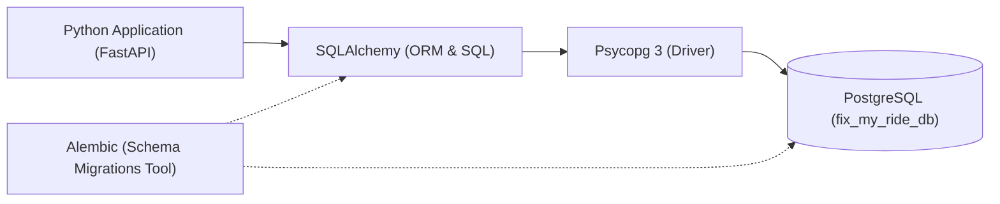

# Commit 22: Configure Database Dependencies

**Phase:** Phase 2 — Database Foundation  
**Increment:** Commit 22

---

## 1. Commit Objective

The objective of **Commit 22** is to declare and install the three core Python database libraries inside `backend/requirements.txt` and `backend/.venv`:

1. **`SQLAlchemy>=2.0,<3.0`**
2. **`psycopg[binary]>=3.2,<4.0`**
3. **`alembic>=1.14,<2.0`**

> **Important Note:** This commit is strictly about **installing dependencies and understanding what each library does**. FastAPI is **not** connected to PostgreSQL yet (`database.py`, SQLAlchemy engines/sessions, models, and Alembic initialization belong to subsequent commits).

---

## 2. Why Database Libraries Are Required

In Commit 21 we set up the PostgreSQL server and created `fix_my_ride_db`. However, Python and FastAPI do not automatically know how to speak PostgreSQL's network protocol, map database rows to Python objects, or track table structure changes over time. Installing SQLAlchemy, Psycopg 3, and Alembic gives Python the exact tools needed for Phase 2.

---

## 3. Introduction to SQLAlchemy

**SQLAlchemy** is Python's most widely used database toolkit and Object-Relational Mapper (ORM). We selected **SQLAlchemy 2.x** because it offers modern Python type annotations, cleaner syntax (`DeclarativeBase`, `mapped_column`), and predictable session handling.

---

## 4. What Is an ORM?

An **ORM** (*Object-Relational Mapper*) is a bridge between **object-oriented Python code** and **relational database tables**:

- A database table (like `customers`) maps to a Python class (`Customer`).
- A table column (like `name`) maps to a Python attribute (`customer.name`).
- A table row maps to a Python object instance.

---

## 5. SQL vs. ORM

- **Raw SQL:** You write SQL strings by hand (`SELECT id, name FROM customers WHERE id = 1;`) and receive raw tuples/rows that you must manually convert and validate.
- **ORM (SQLAlchemy):** You work with readable Python classes and queries, while SQLAlchemy generates safe parameterized SQL behind the scenes (preventing common mistakes like SQL injection).

---

## 6. Introduction to Database Drivers

A **database driver** is a low-level library that implements a specific database's network wire protocol—handling TCP sockets, authentication handshakes, sending SQL statements, and receiving binary/text results back into Python.

---

## 7. Understanding Psycopg 3

**Psycopg 3 (`psycopg`)** is the modern official PostgreSQL adapter/driver for Python:

- **Why Python needs it:** SQLAlchemy knows how to generate PostgreSQL SQL, but it relies on a PostgreSQL driver like Psycopg to actually send that SQL to `localhost:5432` and read results back.
- **Why Psycopg 3:** It is the modern generation of Psycopg supporting both synchronous and asynchronous Python cleanly.
- **Why `[binary]`:** Installing `psycopg[binary]` ships prebuilt C/libpq binaries so local Ubuntu development works immediately without needing to compile C extensions or install extra `-dev` system headers.

---

## 8. How SQLAlchemy and Psycopg Work Together

At runtime, requests flow cleanly through these layers:



*(Note: **Alembic** sits alongside runtime queries as the dedicated tool that reads your SQLAlchemy models and applies versioned schema migrations to PostgreSQL.)*

---

## 9. Introduction to Alembic

**Alembic** is the database migration tool created by the author of SQLAlchemy. Even though we are installing Alembic now so all Phase 2 dependencies are in place, we will **not** initialize or configure Alembic until we define database models in upcoming commits.

---

## 10. What Are Database Migrations?

As Fix-My-Ride grows, database tables evolve—first we create `customers`, later we add `motorcycles`, then `service_bookings`, and maybe add a new column like `notes` to an existing table.

A **database migration** is a versioned Python script (managed by Alembic) that upgrades (or rolls back) your database schema step by step while keeping a clear **migration history**—much like Git commits track code changes!

---

## 11. Understanding Direct and Transitive Dependencies

- **Direct dependencies:** The packages **our project explicitly imports and lists** in `backend/requirements.txt` (`fastapi`, `uvicorn[standard]`, `pydantic-settings`, `python-dotenv`, `SQLAlchemy`, `psycopg[binary]`, `alembic`).
- **Transitive dependencies:** Helper packages that `pip` installs **automatically** because our direct dependencies need them (for example, `greenlet` for SQLAlchemy, `Mako` for Alembic, and `psycopg-binary` for `psycopg[binary]`).

We list **only direct dependencies** in `requirements.txt` instead of dumping everything from `pip freeze`, keeping `requirements.txt` clean, readable, and easy to upgrade.

---

## 12. Understanding `requirements.txt`

`backend/requirements.txt` uses **compatible version ranges**:

```text
fastapi
uvicorn[standard]
pydantic-settings
python-dotenv
SQLAlchemy>=2.0,<3.0
psycopg[binary]>=3.2,<4.0
alembic>=1.14,<2.0
```

Using ranges like `>=2.0,<3.0` allows safe bug-fix updates while preventing unexpected breaking major-version jumps.

---

## 13. Files Created and Modified

- **Modified:** `backend/requirements.txt` — Added `SQLAlchemy>=2.0,<3.0`, `psycopg[binary]>=3.2,<4.0`, and `alembic>=1.14,<2.0` while preserving all existing Phase 1 dependencies.
- **Modified:** `backend/README.md` — Added Section 15 (*Database Dependencies*) and updated status.
- **Created:** `docs/commits/22-database-dependencies.md` — This learning guide documenting Commit 22.

---

## 14. Installing Dependencies

From the project root:

```bash
cd backend

source .venv/bin/activate

pip install -r requirements.txt
```

*(Never install project packages globally or recreate `.venv` unnecessarily.)*

---

## 15. Verifying Dependencies

Inside the activated virtual environment:

```bash
pip list
pip check
python -c "import sqlalchemy; print(sqlalchemy.__version__)"
python -c "import psycopg; print(psycopg.__version__)"
python -c "import alembic; print(alembic.__version__)"
python -c "from sqlalchemy.dialects.postgresql import dialect; print('PostgreSQL dialect available')"
```

And confirm the existing FastAPI server still starts and serves `/` and `/health` cleanly:

```bash
uvicorn app.main:app --reload
```

---

## 16. What Was Implemented

- Added `SQLAlchemy`, `psycopg[binary]`, and `alembic` to `backend/requirements.txt`.
- Installed all three libraries and their transitive dependencies inside `backend/.venv`.
- Verified package integrity (`pip check`), Python imports, SQLAlchemy PostgreSQL dialect availability, and existing FastAPI endpoints.
- Documented the database libraries in `backend/README.md` and `docs/commits/22-database-dependencies.md`.

---

## 17. What Has NOT Been Implemented

To keep Commit 22 strictly focused on dependencies:

- **No `database.py`, SQLAlchemy `engine`, or database sessions** exist yet (Commit 23).
- **No connection to PostgreSQL** is made by FastAPI yet.
- **No SQLAlchemy models or customer tables** exist yet.
- **No `alembic.ini` or Alembic migration folder** has been initialized yet.

---

## 18. Git Commit Message

Suggested commit message for this step:

```text
chore(backend): configure database dependencies
```
