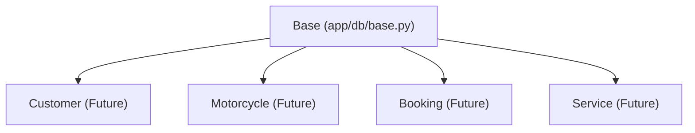

# Commit 24: Establish Database Base Model

**Phase:** Phase 2 — Database Foundation  
**Increment:** Commit 24

---

## 1. Commit Objective

The objective of **Commit 24** is to create the shared **SQLAlchemy 2.x declarative base class (`Base`)** inside `backend/app/db/base.py` so every future Fix-My-Ride database model inherits from one common foundation.

> **Important Note:** This commit introduces **only the empty `Base` class**. No business models (`Customer`, `Motorcycle`, `Booking`, `Service`), database tables, columns, or Alembic migrations are created yet.

---

## 2. Why Database Models Are Needed

In PostgreSQL, data lives inside relational tables made of rows and columns. In Python, application logic works with classes and objects.

A **database model** is a Python class that represents a database table:

- Each class represents a table (for example, `Customer` → `customers`).
- Each attribute on the class represents a column (for example, `name`, `phone`).
- Each instance of the class represents one row in that table.

Using Python model classes keeps database structure readable, type-checked, and consistent across the backend.

---

## 3. ORM Explained

**ORM** stands for **Object-Relational Mapping**—the technique SQLAlchemy uses to map Python classes and objects directly to relational database tables and rows. Instead of writing repetitive raw SQL strings for every query, developers work with clean Python objects while SQLAlchemy handles SQL generation and row conversion.

---

## 4. SQLAlchemy Declarative Mapping Explained

In SQLAlchemy, **declarative mapping** means you declare a database table's structure right inside a normal Python class definition by inheriting from a shared base class. SQLAlchemy inspects that class and automatically registers its table name, columns, constraints, and relationships.

---

## 5. `DeclarativeBase` Explained

In **SQLAlchemy 2.x**, **`DeclarativeBase`** (imported from `sqlalchemy.orm`) is the modern base class used to enable declarative mapping. Compared to older SQLAlchemy 1.x `declarative_base()` helper functions, subclassing `DeclarativeBase` provides cleaner class syntax and full modern Python type-checking support.

---

## 6. What `Base` Means

Inside `backend/app/db/base.py`:

```python
from sqlalchemy.orm import DeclarativeBase


class Base(DeclarativeBase):
    """Shared SQLAlchemy declarative base for all Fix-My-Ride ORM models."""

    pass
```

`Base` is the parent class that every Fix-My-Ride ORM model will inherit from (`class Customer(Base): ...`). By itself, `Base` defines no business columns or methods—it acts purely as the shared registry root.

---

## 7. Metadata Explained

Every `DeclarativeBase` subclass automatically maintains a **`Base.metadata`** object (an instance of SQLAlchemy `MetaData`).

**Metadata** is SQLAlchemy's central catalog collecting information about every registered table, column, primary key, foreign key constraint, and relationship across all models that inherit from `Base`. Right now `Base.metadata.tables` is empty because no models inherit from `Base` yet.

---

## 8. Why We Use One Shared `Base`

If different models inherited from different `DeclarativeBase` classes, each model group would end up in a separate `MetaData` catalog—meaning foreign keys between tables (like linking a `Motorcycle` to a `Customer`) and automated Alembic migrations would not see the full schema together.

Using **one shared `Base`** ensures:

- All Fix-My-Ride tables belong to one unified `Base.metadata` registry.
- Foreign keys and relationships between models resolve cleanly.
- Future Alembic migrations can inspect `Base.metadata` in one place to detect every model in the project.

---

## 9. How Future Models Will Inherit from `Base`



*(Note: `Customer`, `Motorcycle`, `Booking`, and `Service` are **planned future model examples only**—none of these models or tables are implemented in Commit 24.)*

When those models are added in upcoming commits, each class will simply inherit from `Base` (`from app.db.base import Base`), automatically registering itself in `Base.metadata`.

---

## 10. Files Created and Modified

- **Created:** `backend/app/db/__init__.py` — Marks `app/db` as a Python package following existing project conventions.
- **Created:** `backend/app/db/base.py` — Defines `class Base(DeclarativeBase)`.
- **Created:** `docs/commits/24-database-base-model.md` — This learning guide documenting Commit 24.
- **Unchanged:** `backend/app/core/database.py` — Inspected and left unchanged because keeping `Base` in `app/db/base.py` separate from `engine`/`SessionLocal` avoids circular imports.

---

## 11. Code Walkthrough

1. `backend/app/db/__init__.py` establishes the `app.db` Python package cleanly with no unneeded re-exports.
2. `backend/app/db/base.py` imports `DeclarativeBase` from `sqlalchemy.orm` and defines `class Base(DeclarativeBase): pass`.
3. `backend/app/core/database.py` remains focused strictly on `DATABASE_URL`, `engine`, `SessionLocal`, and `get_db()`, keeping dependency flow one-directional with zero circular imports.

---

## 12. How to Verify the Implementation

From `backend/` with `.venv` activated:

```bash
cd backend
source .venv/bin/activate
python -c "
from sqlalchemy.orm import DeclarativeBase
from app.db.base import Base
from app.core.database import engine, SessionLocal, get_db
from app.main import app

print('Base subclass:', issubclass(Base, DeclarativeBase))
print('Metadata tables:', dict(Base.metadata.tables))
print('App title:', app.title)
"
```

Then start Uvicorn and test `GET /health` (making sure not to create tables or run migrations):

```bash
uvicorn app.main:app --reload
curl http://127.0.0.1:8000/health
```

---

## 13. Expected Results

- `issubclass(Base, DeclarativeBase)` prints `True`.
- `Base.metadata.tables` is `{}` (empty, since no models exist yet).
- `app.core.database` and `app.main` import with zero circular imports or errors.
- `GET /health` returns HTTP `200` with `{"status": "healthy", "application": "Fix-My-Ride API", "message": "Backend is running successfully"}`.

---

## 14. What Was Implemented

- Created `backend/app/db/__init__.py` and `backend/app/db/base.py` defining `Base(DeclarativeBase)`.
- Verified `Base` subclassing, empty metadata, clean imports across `app.core.database` and `app.main`, and running health endpoint.
- Documented ORM, declarative mapping, `DeclarativeBase`, and `Base.metadata` in `docs/commits/24-database-base-model.md`.

---

## 15. What Was Deliberately Not Implemented

- No `Customer`, `Motorcycle`, `Booking`, `Service`, or any other ORM model.
- No columns, primary keys, foreign keys, or relationships.
- No database tables (`Base.metadata.create_all(...)` was not called).
- No Alembic setup (`alembic.ini`) or migrations.
- No new API endpoints, dependencies, or frontend changes.

---

## 16. How This Prepares the Project for Commit 25

With `Base` established in `app/db/base.py` and `engine`/`SessionLocal`/`get_db()` ready in `app/core/database.py`, Commit 25 can cleanly initialize Alembic or begin defining Fix-My-Ride's first concrete database models on top of a unified `Base.metadata`.

---

## 17. Suggested Git Commit Message

```text
feat(backend): establish database base model
```
