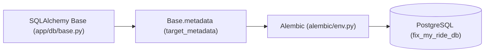

# Commit 25: Configure Alembic

**Phase:** Phase 2 — Database Foundation  
**Increment:** Commit 25

---

## 1. Commit Objective

The objective of **Commit 25** is to initialize and configure **Alembic** inside `backend/` so Fix-My-Ride has a complete, credential-free database migration setup wired directly to `Base.metadata` (`app.db.base`) and our existing SQLAlchemy configuration (`app.core.database`).

> **Important Note:** This commit sets up the **migration infrastructure only**. No business models, migration revisions, or database tables are created or applied yet.

---

## 2. Why Database Migrations Are Needed

A web application's database never stays frozen—it starts with core tables like `customers`, then adds `motorcycles`, `bookings`, and new columns as features grow. Database migrations provide a reliable, repeatable way to evolve PostgreSQL tables across every developer's computer and deployment environment.

---

## 3. What Alembic Is

**Alembic** is the official database migration tool built for SQLAlchemy. It stores ordered Python migration scripts inside `backend/alembic/versions/` and tracks which version has already been applied in a database table named `alembic_version`.

---

## 4. SQLAlchemy vs. Alembic

| Tool | Responsibility |
| :--- | :--- |
| **SQLAlchemy** | Defines Python ORM models (`Base`), manages connection pools (`engine`), and runs runtime queries (`SessionLocal`). |
| **Alembic** | Tracks schema history and generates/applies structural changes (`CREATE TABLE`, `ALTER TABLE`) to PostgreSQL over time. |

---

## 5. What a Migration Means

A **migration** is a versioned Python script with two functions:

- `upgrade()` — Applies the schema change (for example, creating a table or adding a column).
- `downgrade()` — Reverses that change if you ever need to roll back.

---

## 6. Why Manual Database Changes Are Risky

Running ad-hoc `CREATE TABLE` or `ALTER TABLE` commands manually in `psql` creates hidden differences between teammates' databases, leaves no history of *why* or *when* a column changed, and easily causes runtime crashes when Python models don't match PostgreSQL tables.

---

## 7. Alembic Directory Structure

```text
backend/
├── alembic/
│   ├── README
│   ├── env.py
│   ├── script.py.mako
│   └── versions/
└── alembic.ini
```

- `alembic.ini` — Main configuration file read by the `alembic` CLI.
- `alembic/env.py` — Python environment script executed when Alembic runs.
- `alembic/script.py.mako` — Template used to generate future migration files.
- `alembic/versions/` — Directory where future migration revision files will live (currently empty).

---

## 8. Purpose of `alembic.ini`

`backend/alembic.ini` tells Alembic where to find migration scripts (`script_location = %(here)s/alembic`), adds `backend/` to Python's module path (`prepend_sys_path = .`), and configures logging. Crucially, **`sqlalchemy.url` is left empty** in `alembic.ini` so no database passwords or hardcoded URLs ever sit in a committed config file.

---

## 9. Purpose of `env.py`

`backend/alembic/env.py` runs whenever you invoke an `alembic` command. We customized it to connect Alembic directly to Fix-My-Ride's own `Base` and `database.py` instead of maintaining a separate database configuration.

---

## 10. What `target_metadata` Means

`target_metadata = Base.metadata` tells Alembic which SQLAlchemy `MetaData` catalog represents the desired database schema. When Alembic generates future migrations, it compares `target_metadata` against the actual PostgreSQL tables.

---

## 11. How `Base.metadata` Connects SQLAlchemy to Alembic



Every future model inheriting from `Base` registers its table in `Base.metadata`, which `env.py` exposes to Alembic via `target_metadata`.

---

## 12. Offline vs. Online Migration

- **Offline Mode (`--sql`):** `run_migrations_offline()` passes `DATABASE_URL` (rendered via `render_as_string(hide_password=False)`) to Alembic so it can output SQL statements to text without connecting to PostgreSQL.
- **Online Mode (default):** `run_migrations_online()` connects to PostgreSQL using `engine` from `app.core.database` (`with engine.connect() as connection:`), runs migrations inside a transaction, and closes/disposes connections cleanly in `finally: engine.dispose()`.

---

## 13. How Alembic Reads Database Configuration

`env.py` imports `DATABASE_URL` and `engine` directly from `app.core.database`, which reads `Settings` (`backend/.env`) via `app.core.config`. There is only **one** source of truth for database credentials, and zero secrets are printed or stored in `alembic.ini`.

Import relationships remain cleanly one-directional (`env.py` → `app.core.database` → `app.core.config`, and `env.py` → `app.db.base`), preventing circular imports.

---

## 14. How Future Models Will Be Discovered

At Commit 25, no business models exist yet (`Base.metadata.tables` is `{}`). In future commits, model modules (such as a future `Customer` model) must be **imported** before Alembic runs `--autogenerate` so Python executes their class definitions and registers their tables on `Base.metadata`.

---

## 15. Files Created and Modified

- **Created:** `backend/alembic.ini` — Alembic CLI config (`script_location`, `prepend_sys_path`, empty `sqlalchemy.url`).
- **Created:** `backend/alembic/env.py` — Configured with `Base.metadata` and `DATABASE_URL`/`engine` from `app.core.database`.
- **Created:** `backend/alembic/README` & `backend/alembic/script.py.mako` & `backend/alembic/versions/` — Standard generated Alembic files.
- **Modified:** `backend/README.md` — Added Section 17 (*Database Migrations with Alembic*) and updated status.
- **Created:** `docs/commits/25-configure-alembic.md` — This learning guide documenting Commit 25.

---

## 16. Implementation Walkthrough

1. Inspected `requirements.txt`, `config.py`, `database.py`, `base.py`, `main.py`, and Git status from Commit 24.
2. Ran `alembic init alembic` inside `backend/`.
3. Cleared the placeholder `sqlalchemy.url` in `backend/alembic.ini` so no credentials are stored there.
4. Updated `backend/alembic/env.py` to import `Base` from `app.db.base` (`target_metadata = Base.metadata`) and `DATABASE_URL, engine` from `app.core.database` for offline and online migration modes.
5. Updated `backend/README.md` and created this commit guide.

---

## 17. How to Verify Alembic Configuration

From `backend/` with `.venv` active:

```bash
cd backend
source .venv/bin/activate
alembic --version
alembic current
alembic history
alembic heads
alembic check
```

Also verify FastAPI still starts and serves `/health`:

```bash
uvicorn app.main:app --reload
curl http://127.0.0.1:8000/health
```

---

## 18. Expected Verification Results

- `alembic --version` prints `alembic 1.20.1`.
- `alembic history` and `alembic heads` return empty output (no revisions created yet—this is expected).
- `alembic current` and `alembic check` require connecting to PostgreSQL:
  - When `DB_PASSWORD` in `backend/.env` is configured for `fix_my_ride_user`, `alembic current` prints empty/no revision applied yet and `alembic check` reports `No new upgrade operations detected.` (since both `Base.metadata` and `fix_my_ride_db` currently have no tables).
  - If `DB_PASSWORD` is still blank in `backend/.env`, `alembic current` / `alembic check` report a PostgreSQL authentication error (`fe_sendauth: no password supplied`) without exposing credentials.
- FastAPI continues serving `GET /` and `GET /health` cleanly.

---

## 19. What Was Implemented

- Initialized Alembic inside `backend/alembic/` and `backend/alembic.ini`.
- Wired `alembic/env.py` to `Base.metadata` and `app.core.database` (`DATABASE_URL`, `engine`).
- Removed placeholder URL credentials from `alembic.ini`.
- Documented Alembic configuration and concepts in `backend/README.md` and `docs/commits/25-configure-alembic.md`.

---

## 20. What Was Deliberately Not Implemented

- No `Customer` or other ORM models.
- No migration revisions (`alembic/versions/` remains empty).
- `alembic upgrade head` was not executed and no database tables were created.
- No frontend files or dependencies were modified.

---

## 21. How This Prepares Us for Commit 26

With PostgreSQL (`Commit 21`), database libraries (`Commit 22`), SQLAlchemy engine/sessions (`Commit 23`), shared `Base` (`Commit 24`), and Alembic (`Commit 25`) all wired together, Phase 2's database foundation is ready for creating our first concrete ORM models and generating real schema migrations.

---

## 22. Suggested Git Commit Message

```text
chore(backend): configure alembic migrations
```
