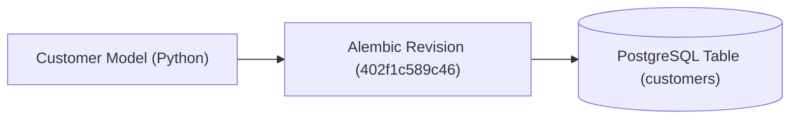

# Commit 27: Create Initial Database Migration

**Phase:** Phase 2 — Database Foundation  
**Increment:** Commit 27

---

## 1. Commit Objective

The objective of **Commit 27** is to generate Fix-My-Ride's first **Alembic** migration revision (`402f1c589c46_create_customer_table.py`) from the `Customer` SQLAlchemy model, review it carefully, apply it to PostgreSQL (`alembic upgrade head`), and verify the newly created `customers` and `alembic_version` tables.

---

## 2. Current State Before This Commit

Before running any migration commands:

- `Customer` (`app/db/models/customer.py`) existed only as a Python class registered in `Base.metadata`.
- `backend/alembic/versions/` contained no migration revisions.
- `fix_my_ride_db` in PostgreSQL had **zero tables** (`[]` — no `customers` table and no `alembic_version` table).

This highlights a crucial distinction: **a Python SQLAlchemy model is only a blueprint in code**, while **the PostgreSQL table does not exist until a migration creates it**.

---

## 3. Why Migrations Are Necessary

Rather than manually typing `CREATE TABLE` statements in `psql` (which leaves no versioned history and causes drift between teammates' databases), migrations record every schema change as an ordered, repeatable Python script checked into Git.

---

## 4. How Alembic Autogenerate Works



When you run `alembic revision --autogenerate -m "create_customer_table"`:

1. Alembic loads `alembic/env.py`, which imports `app.db.models` and sets `target_metadata = Base.metadata`.
2. Alembic connects to PostgreSQL (`fix_my_ride_db`) and inspects what tables currently exist.
3. Alembic compares `Base.metadata` (which has `customers`) against PostgreSQL (which had no tables).
4. Detecting the difference (`Detected added table 'customers'`), Alembic writes a Python migration script in `backend/alembic/versions/`.

---

## 5. What a Migration Revision Is

A **migration revision** is a timestamped/hashed Python file stored inside `backend/alembic/versions/` (`402f1c589c46_create_customer_table.py`). Each revision represents one discrete step in the evolution of your database schema.

---

## 6. Explanation of `revision` and `down_revision`

Inside `402f1c589c46_create_customer_table.py`:

```python
revision: str = '402f1c589c46'
down_revision: Union[str, Sequence[str], None] = None
```

- **`revision`:** The unique ID (`402f1c589c46`) of *this* migration script.
- **`down_revision`:** Points to the *previous* migration ID that must run before this one. Because this is our very first migration, `down_revision` is `None`.

---

## 7. Explanation of `upgrade()`

`upgrade()` runs when applying the migration forward (`alembic upgrade head`):

```python
op.create_table(
    'customers',
    sa.Column('id', sa.Integer(), nullable=False),
    sa.Column('full_name', sa.String(length=150), nullable=False),
    sa.Column('phone_number', sa.String(length=20), nullable=False),
    sa.Column('email', sa.String(length=255), nullable=True),
    sa.Column('address', sa.Text(), nullable=True),
    sa.Column('created_at', sa.DateTime(timezone=True), server_default=sa.text('now()'), nullable=False),
    sa.Column('updated_at', sa.DateTime(timezone=True), server_default=sa.text('now()'), nullable=False),
    sa.PrimaryKeyConstraint('id'),
    sa.UniqueConstraint('email'),
    sa.UniqueConstraint('phone_number'),
)
```

*(Note: `updated_at`'s `onupdate=func.now()` lives on the SQLAlchemy ORM model so SQLAlchemy refreshes `updated_at` whenever an ORM row is updated, while `server_default=now()` sets initial timestamps in PostgreSQL on insert.)*

---

## 8. Explanation of `downgrade()`

`downgrade()` runs if you ever need to undo this revision (`alembic downgrade -1` or `base`):

```python
op.drop_table('customers')
```

It reverses **only** the `customers` table created by this specific revision.

---

## 9. What Happens During `alembic upgrade head`

Running `alembic upgrade head`:

1. Connects to `fix_my_ride_db` using `engine` in `alembic/env.py`.
2. Creates the `alembic_version` tracking table if it does not exist yet.
3. Executes `upgrade()` inside a transaction, creating the `customers` table and its `customers_id_seq` sequence, primary key, and unique constraints.
4. Inserts `'402f1c589c46'` into `alembic_version`.

---

## 10. What `alembic_version` Does

**`alembic_version`** is a small internal table managed automatically by Alembic with a single column (`version_num`) storing the currently applied revision ID (`402f1c589c46`). Whenever you run `alembic upgrade` or `alembic current`, Alembic checks `alembic_version` so it never re-applies an already-run migration.

---

## 11. The Generated `customers` Table Structure

| Column | PostgreSQL Type | Nullable | Default / Constraint |
| :--- | :--- | :--- | :--- |
| `id` | `INTEGER` | `False` | `PRIMARY KEY`, auto-increment (`nextval('customers_id_seq')`) |
| `full_name` | `VARCHAR(150)` | `False` | Required |
| `phone_number` | `VARCHAR(20)` | `False` | `UNIQUE` |
| `email` | `VARCHAR(255)` | `True` | `UNIQUE` |
| `address` | `TEXT` | `True` | Optional |
| `created_at` | `TIMESTAMP WITH TIME ZONE` | `False` | `DEFAULT now()` |
| `updated_at` | `TIMESTAMP WITH TIME ZONE` | `False` | `DEFAULT now()` |

---

## 12. Migration Review Process

Before applying any autogenerated script, always read the file in `backend/alembic/versions/`:

- Check `revision` and `down_revision`.
- Compare every column, length, `nullable` flag, `server_default`, primary key, and unique constraint against `Customer` in `app/db/models/customer.py`.
- Confirm `upgrade()` and `downgrade()` do not contain unexpected drops or unrelated table edits.

---

## 13. Database Safety Precautions

- Always inspect existing tables before generating or applying migrations.
- Never drop databases, drop unrelated tables, or truncate existing data.
- Never overwrite or delete already-applied revision files.
- Never use `alembic stamp head` as a shortcut to skip running `upgrade`.

---

## 14. Commands Used

```bash
cd backend
source .venv/bin/activate
alembic revision --autogenerate -m "create_customer_table"
alembic upgrade head
alembic current
alembic heads
alembic history
alembic check
```

---

## 15. Files Created and Modified

- **Created:** `backend/alembic/versions/402f1c589c46_create_customer_table.py` — Initial Alembic migration creating `customers`.
- **Modified:** `backend/README.md` — Added Section 19 (*Migration Workflow & Schema Verification*) and updated status.
- **Created:** `docs/commits/27-initial-database-migration.md` — This learning guide documenting Commit 27.

---

## 16. Verification Results

- **Pre-migration check:** `fix_my_ride_db` connected cleanly (`SELECT 1` → `1`) with `EXISTING_TABLES: []`.
- **Migration generation:** `alembic revision --autogenerate -m "create_customer_table"` detected `'customers'` and created `402f1c589c46_create_customer_table.py`.
- **Migration application:** `alembic upgrade head` executed `Running upgrade  -> 402f1c589c46, create_customer_table`.
- **Alembic CLI status:**
  - `alembic current` → `402f1c589c46 (head)`
  - `alembic heads` → `402f1c589c46 (head)`
  - `alembic history` → `<base> -> 402f1c589c46 (head), create_customer_table`
  - `alembic check` → `No new upgrade operations detected.`
- **PostgreSQL schema inspection:** Confirmed `['alembic_version', 'customers']` exist, all 7 columns (`id`, `full_name`, `phone_number`, `email`, `address`, `created_at`, `updated_at`) match expected types/nullability/defaults, PK is on `['id']`, unique constraints exist on `['email']` and `['phone_number']`, `alembic_version` holds `'402f1c589c46'`, and `customers` has `0` rows.
- **Application check:** `uvicorn app.main:app` runs cleanly and `GET /health` returns HTTP `200`.

---

## 17. What Was Implemented

- Generated and reviewed `backend/alembic/versions/402f1c589c46_create_customer_table.py`.
- Applied the migration with `alembic upgrade head`.
- Verified live PostgreSQL `customers` and `alembic_version` tables, Alembic CLI status, and FastAPI `/health`.
- Updated `backend/README.md` and created `docs/commits/27-initial-database-migration.md`.

---

## 18. What Was Deliberately Not Implemented

- No Pydantic Customer schemas, service functions, or Customer API endpoints.
- No sample customer rows inserted (`customers` row count is `0`).
- No authentication, motorcycle, or booking tables.
- No frontend changes or additional dependencies.

---

## 19. How This Prepares Us for Commit 28

With the `customers` table live in PostgreSQL (`fix_my_ride_db`) and tracked at revision `402f1c589c46`, the database layer is ready for building Customer Pydantic schemas, service operations, and API endpoints (or additional Phase 2/3 modules) cleanly on top of a verified database schema.

---

## 20. Suggested Git Commit Message

```text
feat(database): create initial customer migration
```
