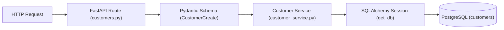

# Commit 30: Implement Customer API

**Phase:** Phase 2 — Database Foundation  
**Increment:** Commit 30

---

## 1. Commit Objective

The objective of **Commit 30** is to expose Fix-My-Ride's first end-to-end backend feature—**Customer HTTP API endpoints** (`POST /api/customers/`, `GET /api/customers/`, and `GET /api/customers/{customer_id}`)—inside `backend/app/api/routes/customers.py` and register them in `backend/app/main.py`.

> **Development-Stage Note:** This is a development-stage API for learning and foundation building, **not production-ready**. Authentication, authorization, rate limiting, and production security hardening remain future work.

---

## 2. What an API Endpoint Is

An **API endpoint** is a specific combination of an HTTP method (like `POST` or `GET`) and a URL path (like `/api/customers/`) exposed by our FastAPI server so clients (browsers, Axios, `curl`, or Swagger UI) can perform actions over HTTP.

---

## 3. What REST API Means

**REST** (*Representational State Transfer*) organizes an API around **resources** (like `customers`) using standard HTTP methods to express actions and standard HTTP status codes to report outcomes.

---

## 4. HTTP Methods Explained

- **`POST /api/customers/`:** Sends JSON data in the request body to **create** a new customer resource.
- **`GET /api/customers/`:** Requests a **list** of existing customer resources without modifying data.
- **`GET /api/customers/{customer_id}`:** Requests **one specific** customer resource identified by its integer `customer_id`.

---

## 5. What `APIRouter` Does

`APIRouter()` in `backend/app/api/routes/customers.py` groups all Customer endpoints inside a dedicated module rather than crowding `main.py`.

---

## 6. How FastAPI Registers Routes

Inside `backend/app/main.py`:

```python
app.include_router(customers_router, prefix="/api/customers", tags=["Customers"])
```

Attaching `prefix="/api/customers"` once in `main.py` turns `@router.post("/")`, `@router.get("/")`, and `@router.get("/{customer_id}")` cleanly into `/api/customers/`, `/api/customers/`, and `/api/customers/{customer_id}` without repeating prefixes.

---

## 7. How the Database Session Is Injected

Each Customer route declares `db: Session = Depends(get_db)`. FastAPI automatically calls `get_db()` from `app.core.database` before running the route, hands the fresh `Session` to the function, and executes `finally: db.close()` after the response finishes—even if an error occurred.

---

## 8. How `Depends()` Works

**`Depends(get_db)`** is FastAPI's **Dependency Injection** system. Instead of creating and closing database sessions manually inside every endpoint, you declare what the endpoint needs (`db: Session = Depends(get_db)`), and FastAPI manages its lifecycle automatically.

---

## 9. How `CustomerCreate` Validates Incoming Requests

When a request hits `POST /api/customers/`, FastAPI parses the JSON body into `customer_data: CustomerCreate`. If `full_name` or `phone_number` is missing, `email` is malformed, or strings exceed `max_length`, FastAPI immediately rejects the request with **`422 Unprocessable Entity`** before the route function or database is ever called.

---

## 10. How the Service Layer Is Called



Routes stay thin: `create_customer_endpoint` calls `create_customer(db=db, customer_data=customer_data)`, `list_customers_endpoint` calls `get_customers(db=db)`, and `get_customer_endpoint` calls `get_customer_by_id(db=db, customer_id=customer_id)`.

---

## 11. How `CustomerResponse` Serializes the Response

Because each route sets `response_model=CustomerResponse` (or `list[CustomerResponse]`) and `CustomerResponse` enables `ConfigDict(from_attributes=True)`, FastAPI converts the returned SQLAlchemy `Customer` ORM object(s) directly into clean JSON without manually building response dictionaries.

---

## 12. HTTP Status Codes Explained

| Status Code | Meaning | When Fix-My-Ride Returns It |
| :--- | :--- | :--- |
| `200 OK` | Request succeeded | `GET /api/customers/` and `GET /api/customers/{customer_id}` when found |
| `201 Created` | New resource created | `POST /api/customers/` succeeds |
| `404 Not Found` | Resource does not exist | `GET /api/customers/{customer_id}` when ID is missing |
| `409 Conflict` | Resource conflicts with existing state | `POST /api/customers/` with duplicate `phone_number` or `email` |
| `422 Unprocessable Entity` | Input validation failed | Missing/invalid fields in JSON body or non-integer `{customer_id}` |

---

## 13. Why `201` Is Used for Creation

`201 Created` specifically signals that a `POST` request succeeded **and created a brand-new record** in PostgreSQL (unlike `200 OK`, which is used for reading existing data).

---

## 14. Why `404` Is Used for Missing Customers

When `get_customer_by_id()` returns `None`, the resource requested at `/api/customers/{customer_id}` does not exist, so the route raises `HTTPException(status_code=404, detail="Customer not found")`.

---

## 15. Why `409` Is Used for Duplicate Customer Information

When `create_customer()` detects a unique constraint violation on `phone_number` or `email`, it rolls back the transaction and raises a clear `ValueError`. The route catches `ValueError` and returns **`409 Conflict`** with a safe message—never exposing raw SQL queries, stack traces, or database credentials.

---

## 16. How API Errors Should Be Handled

- **Validation errors (`422`):** Handled automatically by FastAPI + Pydantic.
- **Business/HTTP errors (`404`, `409`):** Raised cleanly inside the route layer using `HTTPException` (not inside the service layer).
- **Database safety:** Rollbacks occur in `customer_service.py` before errors propagate, and raw database details are never returned to clients.

---

## 17. Files Created and Modified

- **Created:** `backend/app/api/routes/customers.py` — Defines `POST /`, `GET /`, and `GET /{customer_id}` on `APIRouter`.
- **Modified:** `backend/app/main.py` — Imports `customers_router` and registers it at `/api/customers` with tag `"Customers"`.
- **Modified:** `backend/README.md` — Added Section 22 (*Customer HTTP API*) and updated status.
- **Created:** `docs/commits/30-customer-api.md` — This learning guide documenting Commit 30.

---

## 18. Code Walkthrough

1. `customers.py` injects `db: Session = Depends(get_db)` in every endpoint.
2. `create_customer_endpoint` validates `CustomerCreate`, calls `create_customer()`, returns `201 Created` (`CustomerResponse`), and maps `ValueError` to `409 Conflict`.
3. `list_customers_endpoint` calls `get_customers()` and returns `list[CustomerResponse]` (`200 OK`).
4. `get_customer_endpoint` calls `get_customer_by_id()` and returns `CustomerResponse` (`200 OK`) or raises `404 Not Found`.

---

## 19. Available Endpoints

- `GET /` — Root API status
- `GET /health` — Health check
- `POST /api/customers/` — Create customer (`201`)
- `GET /api/customers/` — List all customers (`200`)
- `GET /api/customers/{customer_id}` — Get customer by ID (`200` / `404`)

---

## 20. Example `curl` Commands

**Create a customer (synthetic example):**

```bash
curl -i -X POST http://127.0.0.1:8000/api/customers/ \
  -H "Content-Type: application/json" \
  -d '{
    "full_name": "Arjun Mehta",
    "phone_number": "+919876543210",
    "email": "arjun@example.com",
    "address": "42 Workshop Lane, Bengaluru"
  }'
```

**Sample `201 Created` response:**

```json
{
  "full_name": "Arjun Mehta",
  "phone_number": "+919876543210",
  "email": "arjun@example.com",
  "address": "42 Workshop Lane, Bengaluru",
  "id": 1,
  "created_at": "2026-11-27T03:30:00Z",
  "updated_at": "2026-11-27T03:30:00Z"
}
```

**List and retrieve customers:**

```bash
curl -i http://127.0.0.1:8000/api/customers/
curl -i http://127.0.0.1:8000/api/customers/1
```

---

## 21. How to Test with Swagger UI

Start Uvicorn (`cd backend && source .venv/bin/activate && uvicorn app.main:app --reload`) and open `http://127.0.0.1:8000/docs`. Expand the **Customers** section to inspect schemas, descriptions, status codes, and execute live requests with **Try it out**.

---

## 22. Verification Results

All HTTP tests were executed against FastAPI + Uvicorn connected to live PostgreSQL (`fix_my_ride_db`):

- **OpenAPI / Swagger:** `/openapi.json` confirmed `/`, `/health`, `/api/customers/`, and `/api/customers/{customer_id}` registered; `/docs` returned HTTP `200`.
- **`POST /api/customers/` (valid synthetic customer):** Returned `201 Created` with generated `id`, `created_at`, `updated_at`, and matching fields.
- **Validation (`422`):** Missing `full_name`, missing `phone_number`, invalid `email`, `full_name` > 150, and `phone_number` > 20 all returned HTTP `422`.
- **Duplicates (`409`):** Duplicate `phone_number` and duplicate `email` both returned HTTP `409` with safe `detail` messages (no raw SQL exposed), and a subsequent valid `POST` succeeded (`201`).
- **`GET /api/customers/`:** Returned `200 OK` with a JSON list containing synthetic records (and `[]` once cleaned up).
- **`GET /api/customers/{customer_id}`:** Existing ID → `200 OK`; nonexistent ID → `404 Not Found`; non-integer ID (`/api/customers/abc`) → `422`.
- **Cleanup & existing endpoints:** Deleted only the exact synthetic test records created during verification (`remaining count: 0`), confirmed `GET /` and `GET /health` return `200 OK`, and confirmed `alembic current` remains `402f1c589c46 (head)`.

---

## 23. What Was Implemented

- Created `backend/app/api/routes/customers.py` with `POST /`, `GET /`, and `GET /{customer_id}`.
- Registered `customers_router` in `backend/app/main.py` at `/api/customers`.
- Verified all success and error HTTP status codes against live PostgreSQL.
- Updated `backend/README.md` and created `docs/commits/30-customer-api.md`.

---

## 24. What Was Deliberately Not Implemented

- No authentication, authorization, or rate limiting.
- No customer update (`PUT`/`PATCH`) or delete (`DELETE`) endpoints.
- No pagination, search, or filtering.
- No motorcycle or booking endpoints, no model/migration changes, and no frontend changes.

---

## 25. Phase 2 Completion Summary

Across Commits 21–30 of **Phase 2 — Database Foundation**, Fix-My-Ride now has:

- Local PostgreSQL database (`fix_my_ride_db`) and dedicated application role (`fix_my_ride_user`).
- SQLAlchemy 2.x, Psycopg 3, and Alembic installed and wired to `app/core/config.py`, `app/core/database.py`, `app/db/base.py`, and `alembic/env.py`.
- `Customer` ORM model (`app/db/models/customer.py`) applied cleanly to PostgreSQL via Alembic revision `402f1c589c46`.
- Pydantic 2.x Customer schemas (`app/schemas/customer.py`), Customer service layer (`app/services/customer_service.py`), and end-to-end Customer HTTP endpoints (`app/api/routes/customers.py`).

---

## 26. Suggested Git Commit Message

```text
feat(backend): implement customer api
```
